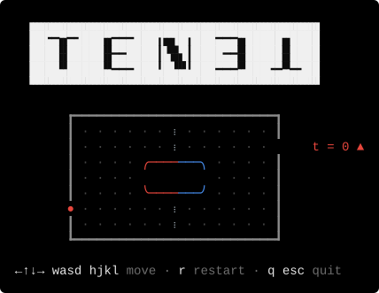

<!-- SPDX-License-Identifier: BSD-3-Clause -->
<!-- SPDX-FileCopyrightText: 2026 Maksym Motorny -->

# Tenet Simulator

A puzzle simulator of strong determinism and time inversion, inspired by Christopher Nolan's *Tenet*. The goal is to build intuition for what it feels like to pass through a turnstile, and to solve time puzzles that seem impossible in the real world.

The world is a 2D top-down grid with discrete time and space, played on hand-designed levels. It runs in the terminal and in the browser from one shared Rust core.

**Play in the browser:** https://mmotorny.github.io/tenet-simulator/



## Status

Early prototype: you can walk the first room and leave through the exit door. Time inversion is not implemented yet; for now the turnstile is a plain passage through the glass wall.

## Legend

| Glyph | Meaning |
|---|---|
| `●` | you, moving forward in time (red) |
| `○` | you, inverted (blue) — coming soon |
| `⋮` `⋯` | glass: you can see through it, but not walk through |
| `╭───╮` | turnstile: red half forward, blue half inverted |
| `⠀` → `⣿` | door, open → closed |

Red always means forward in time and blue means inverted.

## Controls

| Key | Action |
|---|---|
| Arrows, `WASD` or `HJKL` | move |
| `R` | restart |
| `Q` / `Esc` | quit (terminal) |

On touch screens, swipe to move and tap to restart after leaving the room.

## Build and run: terminal

Requires a Rust toolchain ([rustup](https://rustup.rs)).

```sh
git clone https://github.com/mmotorny/tenet-simulator.git
cd tenet-simulator
cargo run --release
```

Use a terminal with true-color support and a font that has box-drawing and Braille glyphs. Set `NO_COLOR=1` or pass `--no-color` for plain output.

Scripted runs print frames instead of opening the interactive view. Moves are `w`/`a`/`s`/`d` (or `h`/`j`/`k`/`l`):

```sh
cargo run --release -- --moves ddddwwdddddddddwwd          # final frame only
cargo run --release -- --moves ddddww --trace              # every frame
cargo run --release -- path/to/level.txt                   # play another level file
```

## Build and run: web

```sh
rustup target add wasm32-unknown-unknown
cargo install wasm-bindgen-cli --version 0.2.130
./build-web.sh
python3 -m http.server 8080 --directory web/www
```

Then open http://localhost:8080.

The screenshot above is generated by the game itself. After changing anything visible, regenerate it (a test fails while it is stale):

```sh
cargo run -q -- --svg > docs/screenshot.svg
```

## Development

```sh
cargo test --workspace
cargo clippy --workspace --all-targets -- -D warnings
```

| Path | Contents |
|---|---|
| `core/` | Deterministic core: levels, rules, and a renderer-agnostic view. No I/O, no dependencies. |
| `core/levels/` | Level maps, one character per cell (legend in `core/src/level.rs`). |
| `cli/` | Terminal front end (crossterm). |
| `docs/` | README screenshot, generated with `--svg`. |
| `web/` | WebAssembly bindings (`src/`) and the static page (`www/`): a minimal terminal emulator showing the same screen as the CLI. |

Every push to `main` is tested, built and deployed to GitHub Pages by `.github/workflows/pages.yml`.

## License

[BSD 3-Clause](LICENSE).
